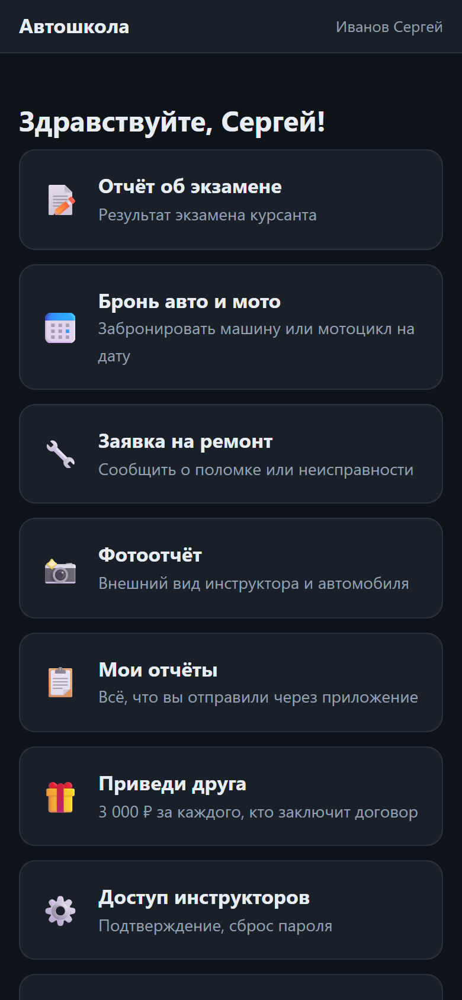
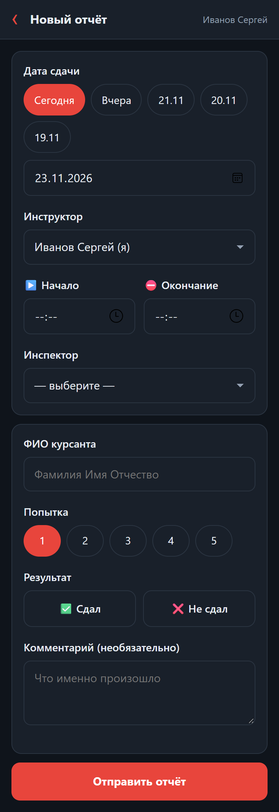
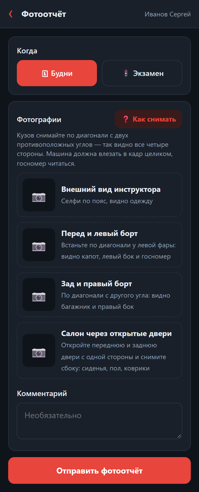
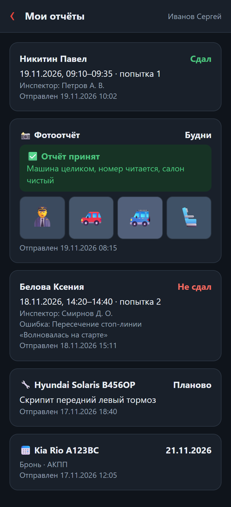

# Портал инструкторов автошколы

**Рабочее PWA-приложение для инструкторов и администраторов: экзамены, автопарк, фотоотчёты и AI-проверка фотографий.**

**Статус:** коммерческий проект, используется более чем 100 сотрудниками · **Формат:** обезличенная публичная копия · **Стек:** PHP 8.2, JavaScript, SQLite, Google Sheets API, S3, Yandex AI Studio.

## Задача и результат

Раньше инструкторы отправляли данные через Telegram-бота. Он работал медленно, иногда требовал VPN, а свободный ввод приводил к ошибкам и неполным данным. Вместо этого был внедрён отдельный веб-портал с формами, проверками и доступом по ролям.

Портал объединяет отчётность по экзаменам, контроль состояния автомобилей, бронирование и ремонт автопарка. Данные экзаменов продолжают поступать в привычный формат Google Sheets — существующую отчётность не пришлось перестраивать.

**Что важно в реализации:**
- **AI-проверка фото:** Yandex AI Studio проверяет снимки по чек-листу; при временном сбое повторная проверка запускается по расписанию.
- **Работа с файлами:** сжатие изображений на клиенте, приватное S3-хранилище и доступ к объектам через подписанные запросы.
- **Интеграции:** Google Sheets, Битрикс24 REST, подтверждение телефона через zvonok.com, переход в реферальный портал без повторного входа.
- **Эксплуатация:** PWA без тяжёлого фронтенд-фреймворка, серверные задания для проверки фото, синхронизации S3 и сбора отзывов.

## Как устроено

```text
Инструктор / администратор
          |
     PWA (JavaScript)
          |
   PHP API + SQLite
      |      |       |
 Google    S3     Yandex AI Studio
 Sheets   фото    проверка фото
      |
 Существующая отчётность

Фоновые PHP-задачи (cron): повторная AI-проверка,
синхронизация фото и сбор отзывов
```

> Публичная версия проекта обезличена: названия, домены, телефоны и ключи заменены или удалены. Показанные экраны используют вымышленные данные.

## Скриншоты

Экраны на вымышленных данных.

<table>
  <tr>
    <td align="center"><br>Вход по номеру</td>
    <td align="center"><br>Главный экран</td>
    <td align="center"><br>Отчёт об экзамене</td>
  </tr>
  <tr>
    <td align="center"><br>Фотоотчёт по схеме</td>
    <td align="center"><br>Мои отчёты и вердикт нейросети</td>
    <td></td>
  </tr>
</table>

## Что умеет

**Для инструктора**
- Вход по номеру телефона с подтверждением звонком. Доступ только у сотрудников из справочника.
- Отчёт об экзамене: курсант, сдал или нет, ошибка, инспектор, номер попытки. Форма с проверками вместо свободного ввода в боте.
- Фотоотчёт: селфи и машина по схеме с подсказками. Фото сжимаются в браузере, хранятся в приватном S3, открываются по ссылке с ключом.
- Проверка фотоотчёта нейросетью по чек-листу. Если модель недоступна, проверка догоняет по расписанию.
- Бронь машины на дату и заявка на ремонт.
- Раздел «Приведи друга»: сквозной вход в реферальный портал без повторной авторизации.

**Для администратора**
- Сотрудники и роли, справочники инспекторов и автопарка.
- Бюджет реферальной программы: сводка, когорты, прогноз.

**Вокруг портала**
- Сбор отзывов о филиалах с Яндекс Карт, 2ГИС и Zoon в Google-таблицу. Дописываются только новые отзывы, поэтому запускать можно сколько угодно раз (`reviews.php`).
- Страницы отзывов по QR для филиалов: высокая оценка ведёт на карты, низкая — во внутреннюю форму, и отзыв уходит в отдел заботы (`review-pages.php`, `review-feedback.php`).

## Стек

- PHP 8.2 без фреймворков, SQLite.
- Фронтенд: ванильный JavaScript, без сборки. PWA: service worker, установка на экран.
- Google Sheets как общая база с руководством: отчёты пишутся в тот же формат, что и раньше от бота, поэтому существующая статистика продолжила работать.
- S3-совместимое хранилище, подписанные запросы реализованы вручную (`s3.php`).
- Yandex AI Studio для проверки фото.
- Битрикс24 REST, zvonok.com (подтверждение звонком).

## Структура

```
app/              серверная логика (вне веб-корня)
  config.php      настройки, ключи читаются из app/.env
  lib.php         БД, сессии, вход, Google Sheets, отчёты
  s3.php          клиент S3
  ai-check.php    догоняющая проверка фото по расписанию
  s3-sync.php     выгрузка фото в S3, чистка локального кэша
  reviews.php     сбор отзывов с площадок
  review-*.php    страницы отзывов по QR
public/           веб-корень
  index.php       API и роутер
  app.js          SPA
  sw.js           service worker
  review/         скрипт для страниц отзывов на сайте школы
```

## Запуск

1. PHP 8.2+ с расширениями `pdo_sqlite`, `curl`, `openssl`, `mbstring`, `gd`.
2. Скопируйте `app/env.example` в `app/.env` и заполните ключи. Ключ сервисного аккаунта Google положите в `app/google-key.json`.
3. Веб-корень — `public/`, все запросы, кроме статики, идут на `public/index.php` (для Apache есть `.htaccess`).
4. Папка `app/data/` должна быть доступна PHP на запись.
5. Крон по желанию: `ai-check.php`, `s3-sync.php`, `reviews.php`, `review-pages.php`.
